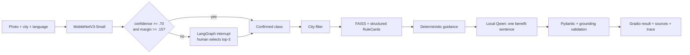

# BinWise AI — “Where Does This Go?”

A friendly computer-vision assistant that identifies a waste item and returns sourced disposal
guidance for **Zurich** or **Gurugram** in English, German, or Hindi. It is designed as an
explainable AI-engineering portfolio project: the vision model predicts, a person confirms
uncertain cases, and deterministic municipal rules—not an LLM—decide the disposal action.

> Project status: the application, training pipeline, workflow, rule corpus and tests are ready.
> Model metrics and the public Space URL should be added only after the Colab training run.

## Why this is more than a chatbot

- Fine-tunes MobileNetV3-Small on 4,752 RealWaste images with a reproducible 70/15/15 split.
- Uses a real LangGraph interrupt/resume checkpoint for low-confidence classification.
- Filters retrieval by city **before** similarity ranking in local FAISS indexes.
- Keeps the actionable guidance deterministic and tied to a versioned `rule_id`.
- Gives Qwen2.5-0.5B only one constrained job: write a short positive explanation.
- Validates grounding, preserves official links, exposes an execution trace and stores no images.

## Architecture



The full state transitions and safety boundaries are documented in
[`docs/design-decisions.md`](docs/design-decisions.md).

## Quick start (without training)

```bash
python -m venv .venv
# Windows: .venv\Scripts\activate
# macOS/Linux: source .venv/bin/activate
pip install -e ".[app]"
```

The UI requires fine-tuned weights. Configure either a local file or a Hugging Face model repo:

```bash
# local weights
set BINWISE_WEIGHTS_PATH=artifacts/model/mobilenet_v3_small.safetensors

# or Hugging Face Hub (PowerShell)
$env:BINWISE_MODEL_REPO="your-name/binwise-realwaste-mobilenet"
python app.py
```

If no weights are configured, the UI reports that fact instead of silently using an untrained
network. Set `BINWISE_ENABLE_LLM=0` to skip Qwen and use the reviewed deterministic explanation.

## Train free in Google Colab

Open [`notebooks/train_realwaste_colab.ipynb`](notebooks/train_realwaste_colab.ipynb) in Colab and
run its cells in order. The equivalent commands are:

```bash
pip install -e ".[app,train]"
python scripts/download_realwaste.py
python scripts/create_split.py data/raw/realwaste
python scripts/train.py --batch-size 64
huggingface-cli login
python scripts/upload_model.py YOUR_HF_NAME/binwise-realwaste-mobilenet
```

Training runs in two explicit phases:

1. Frozen backbone, classifier head for 3 epochs, AdamW at `1e-3`.
2. Final two backbone blocks unfrozen, up to 7 epochs at `1e-4`; patience 2 on validation macro-F1.

If Colab disconnects after an epoch has completed, resume from the saved checkpoint:

```bash
python scripts/train.py --resume artifacts/model/last_checkpoint.pt
```

The run writes measured accuracy, macro-F1, top-three accuracy, per-class precision/recall,
confusion matrix, `safetensors` weights, resumable last checkpoint, and a populated model card to
`artifacts/model/`. No result is hard-coded in this README or intended CV bullet.

## Test

Core tests do not download models or call paid APIs:

```bash
pip install -e .
python -m unittest discover -v
```

With all development dependencies:

```bash
pip install -r requirements-dev.txt
pytest
ruff check .
```

The suite covers all 18 city/material combinations, language coverage, mandatory city filtering,
both confidence thresholds, interrupt/resume, user override, official-source fallback, grounding,
and trace privacy. The split test also verifies that one image cannot occur in multiple splits.

## Publish to Hugging Face Spaces

1. Create a public **Gradio / ZeroGPU** Space.
2. Add `BINWISE_MODEL_REPO` as a Space variable—not a secret because it is a public model ID.
3. Keep GitHub canonical and add the Space as a second remote:

```bash
git remote add space https://huggingface.co/spaces/YOUR_HF_NAME/binwise-ai
git push space main
```

The `@spaces.GPU` callbacks request GPU only while inference runs. If ZeroGPU eligibility is not
available, run the same UI on a regular CPU Space (slower), use the Colab demo, and publish the
recorded walkthrough. See the current [ZeroGPU documentation](https://huggingface.co/docs/hub/main/en/spaces-zerogpu).

## Data, sources and responsible use

- [UCI RealWaste](https://archive.ics.uci.edu/dataset/908/realwaste): 4,752 images, nine classes,
  CC BY 4.0, DOI `10.24432/C5SS4G`. The 656 MB dataset is downloaded by script and not committed.
- Zurich guidance links to the City of Zurich's official English disposal guide.
- Gurugram guidance links to the Municipal Corporation portal and CPCB Solid Waste Management
  Rules. The app uses cautious category-level guidance and directs users to the current local rule.
- German and Hindi text is machine-assisted and explicitly labelled as such.
- Images are kept only in memory; there is no image storage, tracking, authentication or analytics.

Waste rules and accepted materials change. BinWise is educational and always shows its source and
verification date. Special, hazardous, medical, electronic and construction waste should be routed
through the current official service.

## Repository map

```text
app.py                         Gradio / ZeroGPU entry point
data/rules.json                18 multilingual, sourced RuleCards
src/binwise/classifier.py      MobileNetV3 inference and Hub weight loading
src/binwise/retrieval.py       city-first FAISS retrieval with safe fallback
src/binwise/workflow.py        typed LangGraph interrupt/resume workflow
src/binwise/explanation.py     constrained local Qwen + deterministic fallback
src/binwise/training.py        split, training, evaluation and export
scripts/                       download, train, index and upload commands
tests/                         offline acceptance and golden coverage tests
docs/                          design rationale, demo and interview practice
```

## Portfolio completion checklist

- [ ] Train in Colab and retain the measured test report.
- [ ] Confirm test macro-F1; investigate classes if it is below the 0.80 target.
- [ ] Upload weights/model card to the Hub and configure the Space.
- [ ] Run 20 representative images and record end-to-end p95 excluding the external queue.
- [ ] Add the confusion matrix and one trace screenshot here.
- [ ] Record the three-minute walkthrough in [`docs/demo-script.md`](docs/demo-script.md).
- [ ] Write the CV bullet from the measured results—never from the target.

## License

Project code is MIT-licensed. The RealWaste dataset remains CC BY 4.0 under its original authors'
terms. Official municipal text and links remain subject to their publishers' terms.

